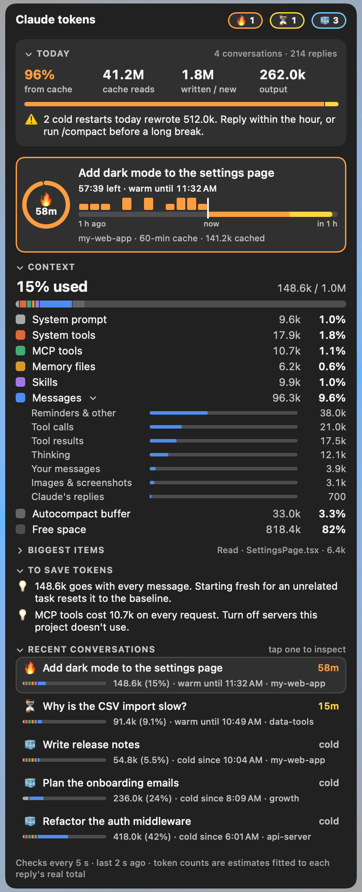
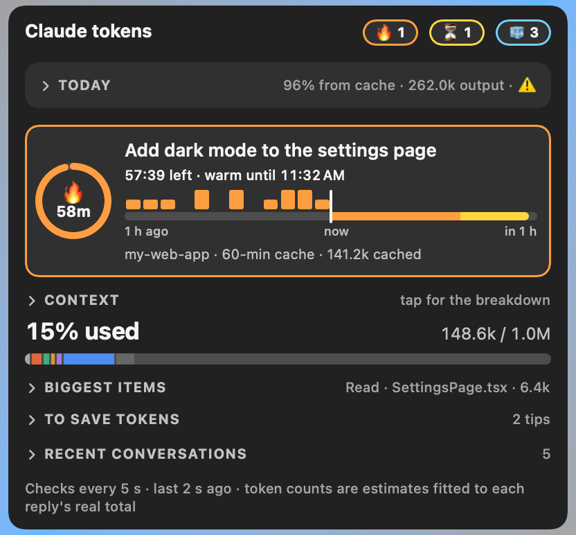

# Claude Cache

A macOS menu bar app that shows how much of your plan's 5-hour and weekly limits you've used, whether Claude's prompt cache is still warm for your recent conversations, what is filling each conversation's context, and what you could change to spend fewer tokens.

It reads the conversation logs that Claude Code and the Claude desktop app already keep on your Mac. The only thing it asks the internet for is your plan usage, from Anthropic ([Privacy](#privacy)).

<p align="center">
  
  &nbsp;
  
</p>

<sub>Screenshots use made-up conversations (`tools/demo.json`).</sub>

## Why

Claude caches the start of each request on Anthropic's servers. While the cache is warm, the next message reads the whole conversation from it, which is fast and cheap. Once it goes cold, the next message writes the whole context to the cache again. That is slower and costs more.

How long the cache stays warm depends on what wrote it. Claude Code writes a 1-hour cache, and other writes use 5 minutes. Each reply restarts the clock.

Nothing in Claude's own interface tells you how much of that time is left, or what is making the context big. This app does.

## What it shows

**The menu bar** shows the latest conversation's time left: `🔥 42m` while it's warm, `⏳ 12m` in the last 20 minutes, `🧊 cold` once it has expired. After it comes how much of the 5-hour session you've used, e.g. `🔥 42m · 38%`.

**The menu** shows, from top to bottom:

| Section | What it tells you |
|---|---|
| **Plan limits** | How much of the 5-hour session and the week you've used, with a bar for each and when it resets. It also covers any per-model weekly limit your plan has, the same windows Claude Code's `/usage` shows. The bars turn yellow from 60% and red from 85%. |
| **Today** | What share of today's input came from the cache, and the totals for cache reads, writes and output. A warning appears when a cold restart rewrote a whole context. |
| **Cache card** | For the selected conversation: a ring with the minutes left, and when the cache expires. A timeline shows your replies over the past hour, a "now" marker, and the warm window still ahead (yellow for its last 20 minutes). |
| **Context** | The same parts as Claude Code's Context panel: system prompt, system tools, MCP tools, memory files, skills, messages, autocompact buffer and free space. Each part shows its tokens and its share of the context window. **Messages** opens into what the conversation itself is made of: tool calls, tool results, thinking, your messages, images, Claude's replies, and reminders. |
| **Biggest items** | The largest single things in the context, such as a file read, a command's output, or a skill that was loaded. |
| **To save tokens** | Up to three suggestions based on the numbers. For example, MCP tools that cost 10k on every request, shell output worth piping through `grep`, screenshots that could be read as text, or a context that's due for `/compact`. |
| **Recent conversations** | Your five latest conversations, each with its cache state, its context size and a small bar of what fills it. Tap one to inspect it. |

Every time the menu opens, its bars, rings and charts grow in. Sections fold open and shut, the cache ring drains smoothly, and numbers roll when they change. A cache about to go cold, or a limit above 85%, breathes gently to catch your eye. Turning on **Reduce motion** (System Settings › Accessibility › Display) switches it all off.

Tap any section heading to collapse it to a one-line summary. The menu remembers which sections are open. The app re-reads the logs every 5 seconds, and its menu has **Refresh now**, **Open at Login** and **Quit**.

## Install

### From a release DMG

1. Open `Claude Cache.dmg` and drag **Claude Cache** onto **Applications**.
2. Open it. The app is not notarized, so macOS refuses it the first time. Go to **System Settings › Privacy & Security** and click **Open Anyway** next to Claude Cache, then open it again. You can also clear the block in Terminal:
   ```bash
   xattr -dr com.apple.quarantine "/Applications/Claude Cache.app"
   ```
3. Choose **Open at Login** in its menu if you want it to start with your Mac.

### From source

```bash
git clone https://github.com/romeJG/claude-cache.git
cd claude-cache
./build.sh --install
```

| Command | Result |
|---|---|
| `./build.sh` | Builds `build/Claude Cache.app`, one app for both Apple silicon and Intel. |
| `./build.sh --install` | Builds the app, copies it to `~/Applications`, and restarts it. |
| `./build.sh --dmg` | Builds the app and packs `build/Claude Cache.dmg` to share. |

### Requirements

- macOS 13 or later.
- Python 3 at `/usr/bin/python3`. It comes with the Command Line Tools; if it's missing, install them:
  ```bash
  xcode-select --install
  ```
- Building from source needs the Swift compiler, which the same tools provide.
- Claude Code, or the Claude desktop app's Cowork mode, on the same Mac. The app only sees conversations whose logs are on this machine.
- For **Plan limits**: Claude Code signed in on this Mac. Run `claude` in Terminal once and use `/login` if it asks. The desktop app keeps its sign-in elsewhere, so the app can't use it.

## Use it without the menu bar

The scanner also runs on its own in a terminal:

```bash
python3 Sources/claude_cache_watch.py            # live view of your 5 latest conversations, refreshed every 5 s
python3 Sources/claude_cache_watch.py -n 8 -e 30 # 8 conversations, every 30 s
python3 Sources/claude_cache_watch.py --json     # one scan as JSON (what the app reads)
```

## How accurate it is

- **Plan limits:** exactly what Anthropic reports, up to 3 minutes old.
- **Cache timer:** exact, as long as the log is current. It uses the time and the cache lifetime of each conversation's last reply.
- **Today's totals:** exact. Each reply logs its own token counts.
- **Context total:** exact. It is the total input of the latest reply.
- **Each part of the context:** an estimate, fitted so the parts add up to that real total.
  - The system prompt, tools and skills come from the request records Claude Code logs, and land within about 1k of Claude Code's own panel.
  - **Reminders & other** is what's left over, mostly reminders the app adds without logging them. Treat it as "not itemised".
  - Cowork logs don't record the system prompt, so for those conversations it's grouped as **System, tools & reminders**.

[docs/how-it-works.md](docs/how-it-works.md) explains where each number comes from.

## Project layout

```
Sources/
  ClaudeCache/            the menu bar app (Swift, AppKit + SwiftUI)
    main.swift            starts the app
    AppDelegate.swift     status item, menu, 5-second scans, Open at Login
    MenuView.swift        everything inside the menu
    Model.swift           the scan's data, colours and number formatting
  claude_cache_watch.py   reads the logs and plan usage; terminal view and --json for the app
tools/
  preview.sh              renders the menu to PNGs without running the app
  preview/main.swift      the renderer
  demo.json               made-up data for screenshots
build.sh                  builds the app (and the DMG)
docs/                     screenshots and how-it-works.md
```

To check a design change, render the menu in light and dark mode:

```bash
tools/preview.sh                 # demo data → build/preview-light.png, build/preview-dark.png
tools/preview.sh --live          # your own conversations
tools/preview.sh --collapsed     # every section closed
tools/preview.sh --pick 1        # inspect the second conversation
tools/preview.sh --reveal 0.4    # one frame of the grow-in animation
```

## Privacy

- The app reads conversation logs under `~/.claude/projects` and `~/Library/Application Support/Claude`. They never leave your Mac.
- For **Plan limits**, every 3 minutes it asks Anthropic (`api.anthropic.com/api/oauth/usage`, the request behind Claude Code's `/usage`) how much of your plan you've used. It signs that request with Claude Code's sign-in from your login Keychain (the item `Claude Code-credentials`).
  - When that sign-in has expired, the app renews it with Anthropic, as Claude Code does, and saves it back to the same item, so Claude Code stays signed in.
  - The sign-in is never written anywhere else, and it is only sent to Anthropic.
  - This endpoint isn't documented by Anthropic, so it may change.
- It keeps a small cache of its results in `~/Library/Caches/local.claude-cache-bar/`: the scan, and the usage percentages. The cache never holds the sign-in.
- It makes no other network requests.
